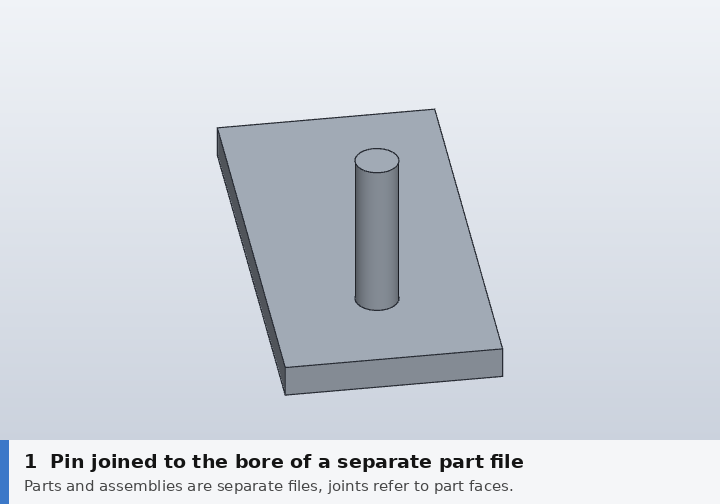
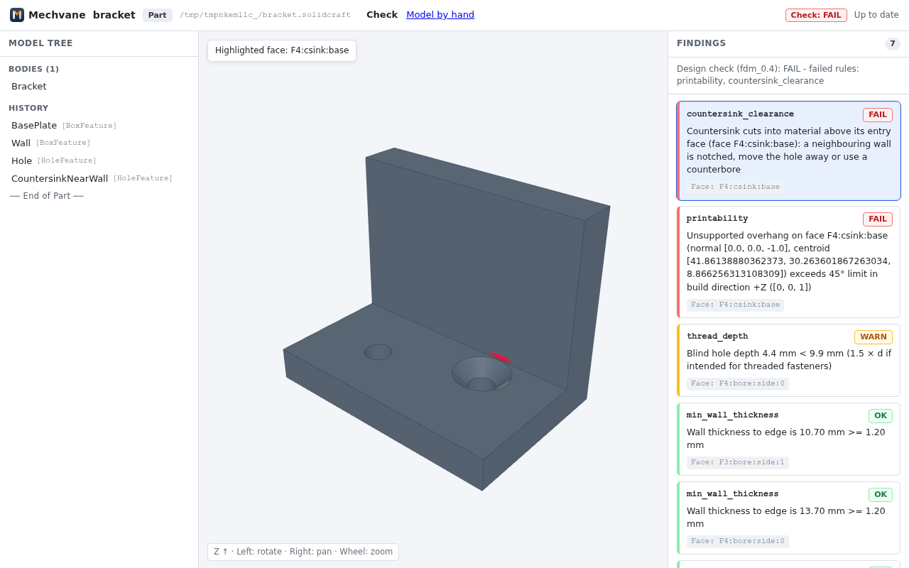

# Mechvane

Parametric 3D CAD for everyday mechanical engineering (individual engineers, makers,
small and medium-sized companies), following the workflow of classic mechanical CAD systems
and rethought for AI agents. The core stays small; domain modules (sheet metal, standard
parts, frames, drawings …) load only when a document or the user needs them.

**[Try the web UI in your browser](https://mechvane.github.io/mechvane/)**: example models with the model
tree and design check findings, nothing to install.



*Change a part, and `update_links` notices that a joint jumped to a different bore and
repairs it (regenerate with `python3 tools/demo_update_links.py`).*

## Guiding principles

- **Agents are first-class operators.** Every action is a typed command. GUI, scripts,
  plugins and AI agents (MCP) share one interface, with undo, batch rollback and precise
  error messages.
- **Agents with engineering knowledge.** An open, sourced knowledge catalog: standard
  values from freely accessible sources, best practice from public handbooks and design
  guides, our own measurement series on the printer. Every rule carries its source,
  rationale, exceptions and severity (error or hint), so agents design like experienced
  engineers and `check_design` does not guess.
- **No dead weight.** What monolithic CAD suites carry around (piping, cable harness, BIM,
  rendering studio …) is a plugin here or left out.
- **Proven workflows where they work.** Design accelerators (bolted connections, shafts,
  gears), frame generator, standard parts, ISO drawings with parts list, rule-based
  configuration.
- **Text- and git-friendly file format.**

## Foundation

Mechvane builds on [SolidCraft](https://github.com/tangency-labs/solidcraft) (Rust,
Apache-2.0), an open CAD kernel and app where "everything is a command", with a built-in
MCP server. SolidCraft stays unchanged as a dependency; Mechvane adds its own layer on top
([ADR 0001](docs/adr/0001-grundlage-solidcraft.md)).

## Quick start

Requirements: Python ≥ 3.11 with the `mcp` package, and `solidcraft-cli` v0.19.0 or later
from a [SolidCraft release](https://github.com/tangency-labs/solidcraft/releases) on your
`PATH` (or its path in `SOLIDCRAFT_CLI`). No build needed; rendering works headless too.

```sh
git clone https://github.com/mechvane/mechvane && cd mechvane
pip install mcp
python3 tests/mechvane/check.py      # about 230 checks, a few minutes
python3 tests/reference/check.py     # reference parts with expected values
```

As an MCP server for an agent (e.g. Claude Code), `.mcp.json` in the repo:

```json
{
  "mcpServers": {
    "mechvane": {
      "command": "python3",
      "args": ["-m", "mechvane"],
      "env": {"MECHVANE_WORKSPACE": "./workspace", "PYTHONPATH": "."}
    }
  }
}
```

Then ask, for example: "Build an 80×40×8 plate with four M5 clearance holes, bolt it to a
bracket and check the design." The agent uses `new_part`, `run`, `bolted_connection`,
`add_joint` and `check_design`. When a part changes, `update_links` finds joints that
jumped to a different face and repairs them.
Windows: [docs/installation-windows.md](docs/installation-windows.md) (German).

## Status

Phase 1: a Python prototype running as an MCP server on top of SolidCraft. Separate part
and assembly files, sketches owned by their feature, a model browser in the classic tree
style, joints across files with checking and repair, standard parts (screws, nuts,
washers, ball bearings), a bolted connection assistant with patterns, `check_design` with
design rules, ISO 286 fits and a knowledge catalog of sourced standard values. A read-only
web UI (`python3 -m mechvane.ui <file.solidcraft> [--port 8765]`) shows the 3D model,
the model browser tree and design/joint findings with interactive face highlighting.



*A countersink that notches the wall, highlighted on click (regenerate with
`python3 tools/demo_web_ui.py`).*

## Contents

- [ROADMAP.md](ROADMAP.md): phases, decision points, risks
- [docs/adr/](docs/adr/): architecture decisions
- [MCP server](docs/mechvane-mcp.md) (`mechvane/`): tools, data model, test reports
- [tests/](tests/): layer checks and reference parts
- [docs/research/](docs/research/): research notes and practice tests, dated. Notes
  marked as drafts (e.g. `-flash`, `-gemini`) are unverified unless a check note says
  otherwise.

Most project documentation is in German for now; code and comments are in English.

## License

MIT OR Apache-2.0, at your option (`LICENSE-MIT`, `LICENSE-APACHE`), like SolidCraft, so
code can move in both directions. Contributions are under the same terms. AGPL slicers
such as CuraEngine only run as separate processes and are not part of Mechvane
(`NOTICE`). See [CONTRIBUTING.md](CONTRIBUTING.md).

Mechvane is an independent project and is not affiliated with Autodesk or any other CAD
vendor. Product names only describe workflows.
