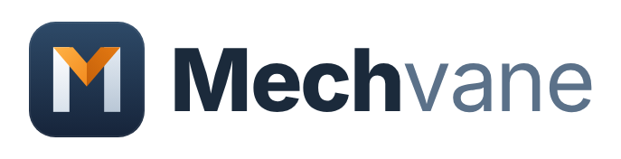
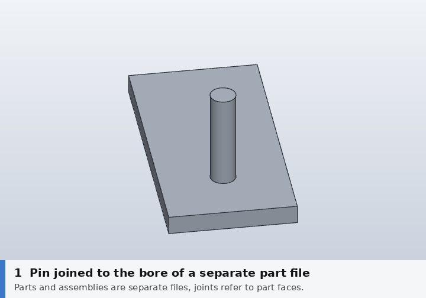
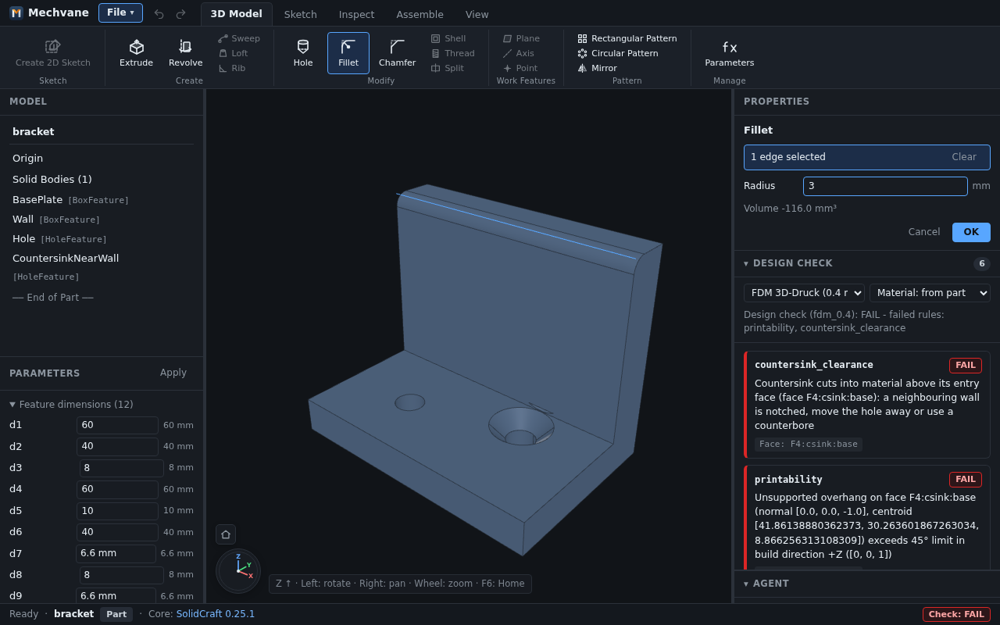

<picture>
  <source media="(prefers-color-scheme: dark)" srcset="https://raw.githubusercontent.com/mechvane/mechvane/main/docs/media/logo-wordmark-dark.png">
  
</picture>

# Mechvane

**You and your agent on the same model.**

**[Website](https://mechvane.dev/)** · **[Live demo](https://mechvane.dev/demo/)** · **[Roadmap](https://mechvane.dev/roadmap/)** · [PyPI](https://pypi.org/project/mechvane/)

Parametric 3D CAD for everyday mechanical engineering (individual engineers, makers,
small and medium-sized companies), following the workflow of classic mechanical CAD systems.
Model by hand, hand a step to an AI agent, or both: you work on the same parts and get the
same design checks either way. The core stays small; domain modules (sheet metal, standard
parts, frames, drawings …) load only when a document or the user needs them.

**[Try it in your browser](https://mechvane.dev/demo/)**: the Mechvane workspace with example models,
the feature dialogs and the design check, nothing to install (SolidCraft runs in the page).



*Change a part, and `update_links` notices that a joint jumped to a different bore and
repairs it (regenerate with `python3 tools/demo_update_links.py`).*

## Guiding principles

- **One model, many hands.** Every action is a typed command. You in the GUI, your scripts,
  plugins and AI agents (MCP) share one interface, with undo, batch rollback and precise
  error messages, so you can pick up where your agent left off and the other way round.
- **Engineering knowledge for you and your agent.** An open, sourced knowledge catalog: standard
  values from freely accessible sources, best practice from public handbooks and design
  guides, our own measurement series on the printer. Every rule carries its source,
  rationale, exceptions and severity (error or hint), so `check_design` does not guess and
  an agent proposes what an experienced engineer would.
- **No dead weight.** What monolithic CAD suites carry around (piping, cable harness, BIM,
  rendering studio …) is a plugin here or left out.
- **Proven workflows where they work.** Design accelerators (bolted connections, shafts,
  gears), frame generator, standard parts, ISO drawings with parts list, rule-based
  configuration.
- **Text- and git-friendly file format.**

## Foundation

Mechvane builds on [SolidCraft](https://github.com/tangency-labs/solidcraft) (Rust,
Apache-2.0), an open CAD kernel and app where "everything is a command", with a built-in
MCP server. SolidCraft stays unchanged as a dependency; Mechvane adds its own layer on top
([ADR 0001](https://github.com/mechvane/mechvane/blob/main/docs/adr/0001-grundlage-solidcraft.md)).

## Quick start

Requirements: Python ≥ 3.11. Everything else comes with `mechvane setup`: it downloads the
pinned `solidcraft-cli` and SolidCraft web app (v0.25.1) from the
[SolidCraft release](https://github.com/tangency-labs/solidcraft/releases) for your platform
(Linux x86_64/aarch64, Windows x64/arm64, macOS) and checks their SHA256. No build needed;
rendering works headless too.

```sh
pip install mechvane
mechvane setup        # SolidCraft CLI and web app, about 90 MB, once
mechvane ui --demo    # example models in their own app window
mechvane ui my-project/   # your own .solidcraft files
mechvane shortcut     # optional: start menu entry for ~/Mechvane (Windows, Linux)
```

`mechvane ui` opens an app window when Chrome, Edge, Chromium or Brave is installed (no tabs, no
address bar; closing it stops Mechvane), otherwise a tab in your default browser. `--browser`
always uses a tab. Everything runs locally and offline after `mechvane setup`.

Alpha: tested on Linux and Windows 11 (x64); macOS is expected to work but not yet tested.
If `mechvane` is not found after a user install on Windows, use `python -m mechvane setup` (and
`ui`, `mcp`) instead.

An existing `solidcraft-cli` is used when you set `SOLIDCRAFT_CLI` or skip `mechvane setup`
and have it on your `PATH`.

As an MCP server for an agent (e.g. Claude Code), `.mcp.json` in your project:

```json
{
  "mcpServers": {
    "mechvane": {
      "command": "mechvane",
      "args": ["mcp", "--workspace", "./workspace"]
    }
  }
}
```

For development, clone the repo and run the checks:

```sh
git clone https://github.com/mechvane/mechvane && cd mechvane
pip install -e .
python3 tests/mechvane/check.py      # about 400 checks, a few minutes
python3 tests/reference/check.py     # reference parts with expected values
```

Then ask, for example: "Build an 80×40×8 plate with four M5 clearance holes, bolt it to a
bracket and check the design." The agent uses `new_part`, `run`, `bolted_connection`,
`add_joint` and `check_design`. When a part changes, `update_links` finds joints that
jumped to a different face and repairs them.
Windows: [docs/installation-windows.md](https://github.com/mechvane/mechvane/blob/main/docs/installation-windows.md) (German).

## Status

Alpha, Phase 1: Mechvane runs as a Python layer on top of SolidCraft, as an MCP server for your agent and as a
web UI on your computer.

- **Workspace** in the layout of classic mechanical CAD (`mechvane ui`): ribbon, model browser, properties and
  design check. Dialogs with live preview for extrude, revolve, hole (clearance, tapped, counterbore, countersink
  from ISO/DIN tables), fillet, chamfer, rectangular and circular pattern and mirror; double-click a feature to
  edit it, right-click to delete it. One Undo list for your own steps and your agent's.
- **Your agent in the app**: a chat next to the model; select faces and say what should happen there.
- **Parts and assemblies** as separate files, joints across files that `update_links` checks and repairs,
  standard parts (screws, nuts, washers, ball bearings) and a bolted connection assistant.
- **Design check** with sourced rules, ISO 286 fits and an open knowledge catalog.
- **Expert mode**: the SolidCraft web app embedded for everything the workspace does not have yet.

Sketching in the workspace is being reworked to work like Inventor and Fusion (a sketch environment with its own
tools); until then, sketches come from your agent or the expert mode. See the
[roadmap](https://mechvane.dev/roadmap/).



*Pick an edge, type a radius, and the preview shows the fillet before you press OK. SolidCraft computes it
underneath.*

## Contents

- [CHANGELOG.md](https://github.com/mechvane/mechvane/blob/main/CHANGELOG.md): what changed in each release
- [mechvane.dev](https://mechvane.dev/): the project website
- [Roadmap at a glance](https://mechvane.dev/roadmap/): what is available, what comes next
- [ROADMAP.md](https://github.com/mechvane/mechvane/blob/main/ROADMAP.md): phases, decision points, risks (detailed, in German)
- [docs/adr/](https://github.com/mechvane/mechvane/tree/main/docs/adr): architecture decisions
- [MCP server](https://github.com/mechvane/mechvane/blob/main/docs/mechvane-mcp.md) (`mechvane/`): tools, data model, test reports
- [tests/](https://github.com/mechvane/mechvane/tree/main/tests): layer checks and reference parts
- [docs/research/](https://github.com/mechvane/mechvane/tree/main/docs/research): research notes and practice tests, dated. Notes
  marked as drafts (e.g. `-flash`, `-gemini`) are unverified unless a check note says
  otherwise.

Most project documentation is in German for now; code and comments are in English.

## License

MIT OR Apache-2.0, at your option (`LICENSE-MIT`, `LICENSE-APACHE`), like SolidCraft, so
code can move in both directions. Contributions are under the same terms. AGPL slicers
such as CuraEngine only run as separate processes and are not part of Mechvane
(`NOTICE`). See [CONTRIBUTING.md](https://github.com/mechvane/mechvane/blob/main/CONTRIBUTING.md).

Mechvane is an independent project and is not affiliated with Autodesk or any other CAD
vendor. Product names only describe workflows.
