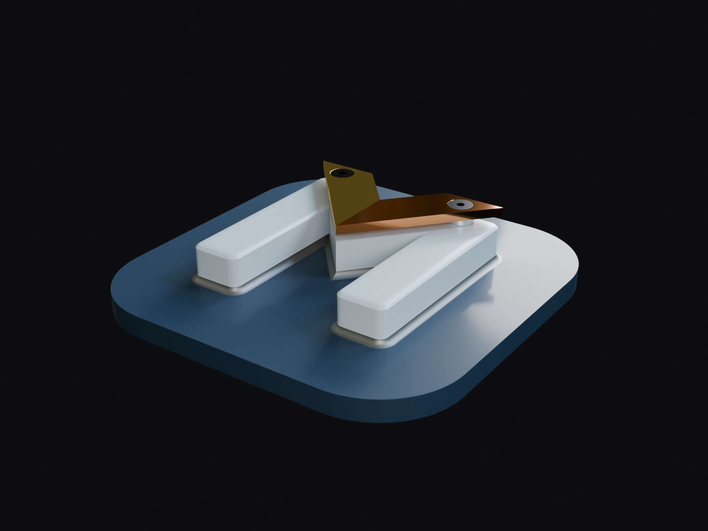

# Logo als Testmodell (Konstruktion und Rendering)

Das Mechvane-Logo als echte Baugruppe, Testfall für Werkstoffe, Verschraubung, Schweißnähte und den
Weg nach Blender ([ADR 0004](../../adr/0004-darstellungsformat.md)).




## Inhalt

- `model/` – SolidCraft-Dateien, mit Mechvane gebaut (`tools/build_logo_showcase.py`):
  - `logo_showcase.solidcraft` – Baugruppe (Teile relativ verknüpft, Gelenke fest)
  - `logo_m.solidcraft` – Grundplatte mit vollständigem M, Stahl, Kehlnähte rundum als konkave Rundung r 2,
    Rundungen und Fasen; zwei M3-Gewindesacklöcher
  - `logo_v.solidcraft` – V in zwei Hälften (2,5 mm), je eine Senkbohrung
  - `spacer.solidcraft` – Distanzscheibe Ø 8 × 2, vorgebohrt
  - `ISO_10642_M3x6.solidcraft` – Senkschraube, von Mechvane erzeugt, brüniert
  - Werkstoffe aus dem Katalog (S235JR, CuZn39Pb3, 1.4301, Kupfer) und Aussehen in SolidCraft zugewiesen
    (Platte navy, M hellgrau, Nähte metallisch, Messing, Kupfer, Edelstahl)
  - `logo_showcase.gltf` – mit `export_gltf` aus der Baugruppe, Aussehen aus den SolidCraft-Teilen
  - `werkstoffe.solidcraft-library.json` – die Werkstoffbibliothek, aus der die Teile ihre Werkstoffe haben
- `blender/` – Szene für Blender 5.x (Cycles):
  - `logo_showcase.blend` (schräg) und `logo_showcase_top.blend` (Draufsicht, 120 mm) – Modell, Werkstoffe (Pulverbeschichtung navy/hellgrau, Messing gebürstet,
    Kupfer poliert, Edelstahl, brünierte Schrauben), Licht, Kamera
  - `env.hdr` – Panorama „Vintage Measuring Lab“ von [Poly Haven](https://polyhaven.com/a/vintage_measuring_lab)
    (CC0); die Kamera sieht dunkelgrauen Hintergrund, Spiegelungen und Licht kommen aus dem Panorama.
    Muss neben der `.blend` liegen.
  - `logo_showcase.gltf` – dasselbe Modell mit Werkstoffen als glTF 2.0 (Klarlack, Anisotropie), Weg B der
    ADR-0004-Probe; lässt sich in Blender oder three.js öffnen.

## Neu bauen

```sh
python3 tools/build_logo_showcase.py                  # Modell + OBJ je Körper in workspace/logo_showcase/
curl -L -o workspace/logo_showcase/render/env.hdr \
  https://dl.polyhaven.org/file/ph-assets/HDRIs/hdr/2k/vintage_measuring_lab_2k.hdr
cp tools/render_logo_blender.py tools/logo_looks.json workspace/logo_showcase/render/
blender -b --python workspace/logo_showcase/render/render_logo_blender.py   # ROUTE=gltf: glTF-Weg, VIEW=top: Draufsicht
python3 tools/logo_to_gltf.py                         # glTF aus denselben Netzen und tools/logo_looks.json
```

Die Werkstoffe stehen als OpenPBR-Parameter in `tools/logo_looks.json`.
