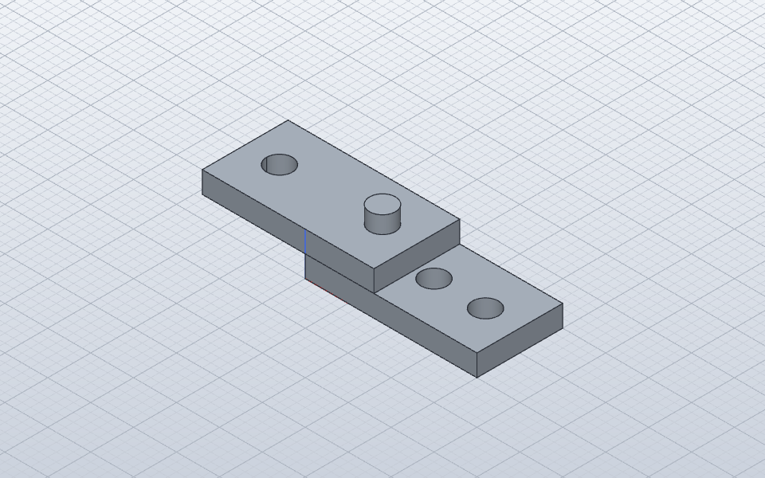
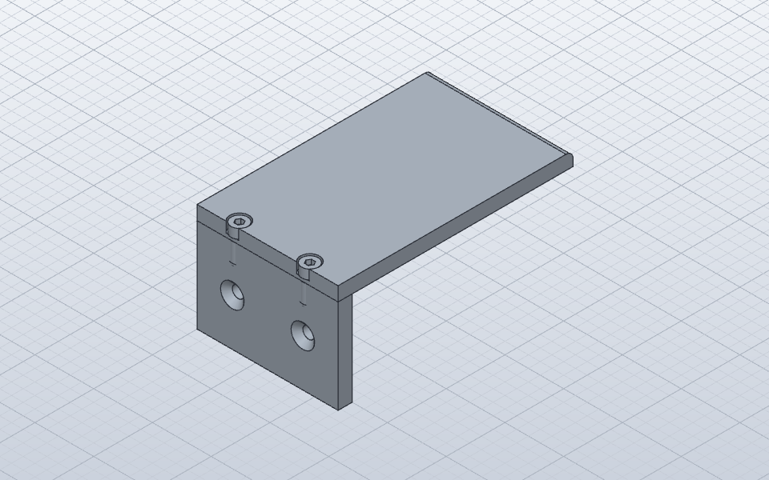

# Mechvane-MCP-Server

Prototyp der Mechvane-Schicht nach [ADR 0001](adr/0001-grundlage-solidcraft.md),
Stand 2026-10-20. Python (`mechvane/`), läuft vor `solidcraft-cli mcp`.

## Modell

- **Bauteil** = eine `.solidcraft`-Datei ohne Komponenten, mit eigenem
  Verlauf und eigenem Bauteilende.
- **Baugruppe** = eine `.solidcraft`-Datei mit verknüpften Bauteilen
  (`component.insert_design`), Unterbaugruppen und Gelenken.
- Die Art steht in den Metadaten der Datei unter
  `dev.mechvane` (`kind`, `format`, bei Normteilen `standard`
  mit `{norm, size, designation, dimensions, …}`, bei Baugruppen `joints` mit
  den Verankerungen sowie `subassemblies` mit der Zuordnung eingefügter
  Unterbaugruppen-Komponenten zu ihren Dateien, Teilen und Gelenken). Ohne
  diesen Eintrag gilt eine Datei mit verknüpften Komponenten als Baugruppe,
  sonst als Bauteil.
- Jedes offene Dokument läuft in einer eigenen SolidCraft-Sitzung. Alle
  Sitzungen dürfen unter dem Arbeitsordner lesen und schreiben
  (`MECHVANE_WORKSPACE`, in `.mcp.json` `/root/repos/inventa/workspace`, nicht
  im Git).

## Werkzeuge

| Werkzeug | Zweck |
|---|---|
| `new_part(name, path, overwrite)`, `new_assembly(name, path, overwrite)` | Leeres Bauteil bzw. leere Baugruppe im Workspace anlegen und speichern. Existiert die Zieldatei bereits auf Disk, wird ein Fehler geworfen, außer es wird ausdrücklich `overwrite=true` übergeben |
| `open_document(path, name)` | Bauteil- oder Baugruppendatei öffnen (Pfad relativ zum Workspace). Ist dieselbe Datei bereits geöffnet, wird das vorhandene Dokument zurückgegeben statt einer Parallelsitzung; Namenskonflikte werden mit klarem Fehler abgewiesen |
| `save_document(document)` | Offenes Dokument auf die Festplatte schreiben |
| `close_document(document, discard)` | Dokument schließen. Hat das Dokument ungespeicherte Änderungen, wird ein Fehler mit Hinweis gemeldet, außer es wird ausdrücklich `discard=true` übergeben |
| `list_documents()` | Liste aller aktuell im Workspace geöffneten Dokumente und Arbeitsordner-Pfad |
| `standard_part(norm, size, length, name, path)` | Parametrisches Normteil als eigene Bauteildatei erzeugen, speichern und offen halten (ISO 4762, ISO 10642, ISO 4032, ISO 7089, Ruthex, DIN 625) |
| `list_standard_parts(norm)` | Verfügbare Normteile und Größen bzw. Maßtabelle einer Norm |
| `run(document, commands, verbose)` | SolidCraft-Befehle als Batch (alles oder nichts). In Bauteilen danach die Skizzenregel; schlägt die Skizzenregel fehl, wird der Befehlsbatch per Checkpoint automatisch zurückgerollt. Antwort ohne leere Felder und Zeiten, außer mit `verbose` |
| `browser(document, groups)` | Modellbrowser nach Inventor-Art, als Text und JSON; `groups` zeigt dieselben Einträge zusätzlich in Ordnern (siehe unten) |
| `delete_feature(document, feature, keep_sketch)` | Feature löschen, die eigene Skizze geht mit |
| `insert_part(assembly, part_path, name, translate, rotate, grounded)` | Bauteil oder Unterbaugruppe verknüpft einfügen (optional Drehung vor dem Fixieren) |
| `add_joint(assembly, params)` | Gelenk anlegen (Parameter wie `joint.create`, `name` Pflicht, Occurrence auch als `Sub:1/Part:1`) und die Bauteilflächen merken |
| `edit_joint(assembly, joint, params)` | Gelenk ändern (wie `joint.edit`, z. B. `flip`, `offset`, `name` zur Umbenennung); Verankerung und Metadaten werden auch bei Umbenennung ohne verwaiste Einträge weitergeführt |
| `delete_joint(assembly, joint)` | Gelenk löschen, Verankerung vergessen |
| `adopt_joint(assembly, joint)` | fremdes Gelenk (App, rohes `joint.create`) in die Prüfung aufnehmen; die Reparatur liest seine Parameter aus `joint.list` |
| `update_links(assembly, repair)` | Unterbaugruppen und Bauteil-Verknüpfungen neu lesen, alle Gelenke prüfen (und auf Wunsch reparieren) sowie Verschraubungen gegen geometrische Anker prüfen: Ist ein Anker gewandert (> 1e-3 mm), wird die Verschraubung bei repair=true per edit_bolted_connection atomar an der neuen Position neu aufgebaut; liefert bolted_connections mit Status (ok, moved, moved_repaired, anchor_lost, failed) und shifted_by |
| `check_joints(assembly)` | Gelenke prüfen, ohne neu zu lesen |
| `measure(document)` | In Baugruppen in Weltkoordinaten (mit `occurrence`). Volumen, Fläche, Schwerpunkt, Bounding Box je Körper |
| `list_commands(document, filter)` | Befehlskatalog von SolidCraft mit Parametern |
| `command(document, command, params)` | ein einzelner SolidCraft-Befehl, für Abfragen |
| `screenshot(document, view, path)` | Bild headless; optional direkt als PNG-Datei (`.png`) im Arbeitsordner mit Pfad, Bytezahl und Maßen als schlanke Antwort (überschreibt keine CAD-Dateien oder Nicht-PNG-Dateien) |
| `iso_fit(nominal, fit)` | ISO-286-Grenzabmaße einer Toleranzklasse (`H7`, `k6`) oder einer Passung (`H7/k6`: Spiel min/max in µm, Art), dazu passende Katalogeinträge. IT5–IT11, Bohrungen D–P, Wellen d–p, bis 500 mm, Tabellen in `mechvane/iso286.py` ([Quellen](research/2026-10-23-iso286-tabellen.md)) |
| `check_design(document, profile)` | Bauteil gegen Konstruktionsregeln prüfen (Wandstärken, Randabstände, Einschraubtiefe, Druckbarkeit), Bericht als JSON |
| `bolted_connection(assembly, placement, size, fasteners, fit, counterbore, …, pattern, parts, head)` | Vollständige Verschraubung über Dateigrenzen hinweg: Durchgangsverbindung mit Mutter (ISO 4762 Zylinderkopf oder ISO 10642 Senkkopf via `head="countersunk"`, ISO 7089, ISO 4032), Sackloch-Verschraubung (connection_type="blind") oder 3D-Druck-Variante mit Ruthex-Gewindeeinsatz (use_insert=True); optional mit kreisförmigem oder rechteckigem Muster (`pattern`); optional gezielte Begrenzung auf Bauteile (`parts`: Liste von Occurrence-Namen in Strahlreihenfolge); `head`: 'cap' (Standard DIN 974-1 Flachsenkung) oder 'countersunk' (flächenbündige 90°-Kegelsenkung nach DIN 74 Form F mit ISO 10642); schneidet Bohrungen in Bauteile, erzeugt Normteile und verknüpft sie koaxial |
| `preview_bolted_connection(assembly, placement, size, fasteners, fit, counterbore, …, pattern, parts, head)` | Vorschau: berechnet Klemmlänge, Einschraubtiefe, Schnittgeometrie, Schraubenlänge und Musterpositionen ohne Dateien zu verändern; unterstützt `head="cap"` und `head="countersunk"`; optional mit `parts`-Filterung |
| `list_bolted_connections(assembly)` | Liste aller in einer Baugruppe gespeicherten Verschraubungen (IDs, Parameter, Komponenten, Gelenke, Bohrungsfeatures) |
| `delete_bolted_connection(assembly, id)` | Verschraubung als Einheit entfernen: löscht Normteil-Komponenten und Gelenke in der Baugruppe sowie die erzeugten Bohrungs-Features in allen Bauteildateien, stellt Bauteilvolumen exakt wieder her |
| `edit_bolted_connection(assembly, id, …, head)` | Bestehende Verschraubung ändern (z. B. Größe, Länge, Senkung, fit, Kopfart `head`: 'cap' <-> 'countersunk'): atomar als Löschen und Neuanlegen an denselben Positionen umgesetzt; bei Fehlern wird der vorherige Zustand vollständig wiederhergestellt |
| `find(document, what, where, limit)` | Semantische Abfrage für Flächen (`faces`), Kanten (`edges`) oder Bohrungen (`holes`) mit Filtern (`type`, `normal`, `diameter`, `length`, `area`, `near`, `feature`, `body`, `occurrence`); liefert Kennwerte und `pick`-Punkte für `solid.fillet`/`chamfer`/`joint.create` |
| `edit_in_place(assembly, occurrence, point)` | Bauteildatei hinter einer Occurrence (auch in mehrstufigen Unterbaugruppen wie `Sub2:1/Sub1B:1/PartP:1`) im Workspace öffnen; liefert Dokumentname, 4×4-Transformation und inverse Matrix; optional direkte Umrechnung von `point` |
| `finish_edit(part, update)` | Geändertes Bauteil speichern und in allen verknüpfenden Baugruppen (einschließlich ungeöffneter Zwischenbaugruppen) `update_links(repair=false)` ausführen und auf Disk speichern; nicht geöffnete Dokumente danach wieder schließen; liefert Berichte mit Gelenkwarnungen (`moved`) |
| `to_part_coords(assembly, occurrence, point)` | 3D-Punkt `[x, y, z]` aus Baugruppenkoordinaten in die lokalen Bauteilkoordinaten einer Occurrence umrechnen (saubere Validierung von 3D-Koordinaten) |

## Skizzenregel

Eine Skizze, die genau ein Feature benutzt, gehört diesem Feature: Nach jedem
`run` steht sie im Verlauf direkt vor ihm, der Browser zeigt sie darunter, und
`delete_feature` löscht sie mit. Eine Skizze mit mehreren Verbrauchern bleibt
eine eigene Zeile. Grundlage sind `timeline.dependents` (`deleted_with_it` =
direkte Verbraucher) und `timeline.reorder`. Verweigert SolidCraft ein
Verschieben, bleibt die Skizze stehen und steht in `refused`.

**Arbeitselemente** (Arbeitsebenen, -achsen, -punkte, SolidCraft-Typ
`Construction…`) folgen derselben Regel: Nutzt sie genau eine Skizze oder ein
Feature direkt, gehört das Element dazu, steht direkt davor und erscheint im
Browser darunter (Feature › Skizze › Ebene). Mehrere eigene Elemente (Loft
mit zwei Skizzen, Sweep mit Profil- und Pfadskizze `path_sketch`) stehen als Block vor ihrem Feature.

**Woher die Nutzung kommt:** aus den Definitionen (`timeline.inspect`:
Skizzen per Id, Arbeitselemente per Name) und bei Skizzen aus ihren
Projektionen (`sketch.inspect` → `links`). Unterdrückte und zurückgerollte
Nutzer zählen also mit. Nur die Projektionen einer nicht ausgewerteten
Skizze sind unbekannt. Als zweite Sicherung prüft `delete_feature` vor jedem
Mitlöschen `timeline.dependents` und behält, was noch gebraucht wird
(`kept`).

### Zwei Ansichten, ein Datenmodell

Gespeichert ist nur, wem etwas gehört. Daraus entstehen zwei Ansichten:
verschachtelt nach Inventor-Art (Standard) und mit `groups=true` zusätzlich
Ordner nach Fusion-Art: **Skizzen** und **Arbeitselemente** im Bauteil,
**Beziehungen** (Gelenke mit beiden Teilen) in der Baugruppe. Jeder Eintrag
nennt seinen Besitzer (`→ Extrude1`) oder alle, die ihn teilen. So zeigt die
Ordneransicht alles auf einen Blick, ohne dass zwei Ablagen auseinanderlaufen
können.

## Gelenke über Dateigrenzen

SolidCraft speichert verknüpfte Bauteile als STEP. Dabei gehen die
Flächennamen aus der Bauteildatei verloren, und ein Gelenk kann nach „Update
Links“ still auf eine andere Fläche springen
([#3330](https://github.com/tangency-labs/solidcraft/issues/3330)). Bis das
upstream behoben ist:

1. `add_joint` rechnet jeden Gelenkrahmen auf einem verknüpften Bauteil in
   dessen Koordinaten um und sucht in der Bauteildatei die Fläche, auf der er
   sitzt (Zylinder: Rahmen auf der Achse und parallel; Ebene: Rahmen in der
   Ebene, z parallel zur Normalen). Gemerkt wird der **Lineage-Name aus der
   Bauteildatei** (z. B. `F2:side#1`), bei Zylindern dazu die Lage entlang
   der Achse, bei Ebenen der Versatz zum Flächenschwerpunkt in Bauteilkoordinaten.
2. `update_links` prüft danach jedes Gelenk gegen die Fläche mit diesem Namen,
   wie sie jetzt in der Bauteildatei liegt. Status: `ok`, `moved` (sitzt auf
   einer anderen Fläche, `now_on` nennt sie), `face_missing`, `origin_lost`
   (SolidCraft findet den Ursprung nicht mehr), `unverifiable` (weder Zylinder
   noch Ebene), `joint_missing`.
3. `repair=true` legt verschobene Gelenke an Zylinder- und ebenen Flächen neu an:
   Bei Zylindern wird die verankerte Seite am Mittelpunkt des gemerkten Endes
   der benannten Fläche gewählt, bei Ebenen wird der Ursprung unter Erhalt seiner
   relativen Lage (Versatz zum Flächenschwerpunkt) auf die benannte Ebene zurückgesetzt
   (Alt-Einträge ohne Versatzangabe werden mit Warnung am Flächenschwerpunkt repariert).
   Die andere Seite bleibt dort, wo ihr Rahmen jetzt ist.

## Normteile

`standard_part` (`mechvane/standard_parts.py`) erzeugt Normteile prozedural als
eigene Bauteildateien mit benannten Parametern (`parameters.add`), bemaßten
Skizzen (`sketch.draw.dimensioned`) und Features nach der Skizzenregel, ohne
Inhaltscenter-Datenbank. Gewinde sind auf Nenndurchmesser $d$ mit kosmetischem
`solid.thread` modelliert. Maßtabellen, Vereinfachungen und Quellen im
[Bericht](research/2026-10-20-normteile-gemini.md):

- **ISO 4762** (Zylinderschraube mit Innensechskant, Alias `DIN 912`): M2,5 bis
  M12, Länge `length` frei wählbar, Prüfung gegen die Vorzugslängen der Norm mit
  Warnung bei Nicht-Vorzugslänge; Kopfauflage bei $z = 0$, Schaft entlang $-z$.
- **ISO 4032** (Sechskantmutter Typ 1, Alias `DIN 934`): M2,5 bis M12
  (Parameter `m_nut`, da `m` in SolidCraft für Meter reserviert ist).
- **ISO 7089** (Scheibe, normale Reihe, 200 HV, Alias `DIN 125`): M2,5 bis M12.
- **Ruthex** (Gewindeeinsatz zum Einschmelzen für 3D-Druck, Alias
  `heat_insert`, `gewindeeinsatz`): M2,5 bis M5, mit empfohlener
  Aufnahmebohrung (`mounting_hole`: Durchmesser und Mindesttiefe) in den
  Metadaten.
- **DIN 625** (Rillenkugellager 6000er-Reihe, Alias `ISO 15`, `bearing`): 6000
  bis 6005, vereinfacht als Hüllring mit $d, D, B$.

## Verschraubungsassistent (Bolted Connection)

`bolted_connection` (`mechvane/bolted.py`) erzeugt vollständige, normgerechte
Schraubenverbindungen über Dateigrenzen hinweg (nach Vorbild des Autodesk Inventor
Bolted Connection Generators, angepasst an Mechvanes dateibasierte Architektur):

1. **Geometrieanalyse & Raycast:** Ausgehend von `placement` (`position` und `direction`,
   oder konzentrischer Bezug) ermittelt der Assistent im Baugruppenkontext alle
   durchdrungenen Bauteile, berechnet die Einzeldicken und die Klemmlänge.
   Mit dem optionalen Parameter `parts: list[str]` (Occurrence-Namen der zu verschraubenden
   Bauteile in Strahlreihenfolge) kann die Verbindung gezielt auf die genannten Komponenten
   eingeschränkt werden. Der Strahl endet nach dem letzten genannten Teil, sodass darunterliegende
   Komponenten unberührt bleiben. Ohne `parts` nennt die Fehlermeldung bei zu großer Klemmlänge
   alle durchdrungenen Bauteile und weist auf `parts` hin.
2. **Verbindungstypen:**
   - **Durchgangsverschraubung (`connection_type="through"`, Standard):** Alle Platten
     erhalten ein ISO 273 Durchgangsloch (kanonische SolidCraft-Namen `close`/`normal`/`loose`,
     Aliase `fine`/`f`, `medium`/`m`, `coarse`/`c`), optional zylindrische Senkung nach
     DIN 974-1 (Reihe 1 ohne Scheibe, Reihe 5 mit ISO 7089 Scheibe) in der Startplatte.
     Austrittsseite erhält ISO 7089 Scheibe und ISO 4032 Mutter.
   - **Sackloch-Verschraubung (`connection_type="blind"`):** Obere Platten erhalten
     Durchgangslöcher, das unterste Bauteil eine Kernlochbohrung nach DIN 336 (z. B. M8: Ø 6,8 mm,
     M12: Ø 10,2 mm) mit 118°-Bohrspitze und kosmetischem Gewinde (`solid.hole` mit `diameter` und `thread`). Die
     Bohrtiefe bemisst sich aus der werkstoffabhängigen Mindesteinschraubtiefe
     (VDI 2230 / Roloff-Matek: Stahl $1{,}0 \cdot d$, Grauguss $1{,}25 \cdot d$,
     Aluminium-Guss $2{,}0 \cdot d$, Aluminium-Knet $1{,}4 \cdot d$, Messing $1{,}2 \cdot d$,
     Thermoplaste $2{,}5 \cdot d$ unsicher) plus Gewindeauslauf $a \approx 4 \cdot P$
     (DIN 76-1 Form A). Keine Mutter/Mutterscheibe.
   - **3D-Druck-Variante (`use_insert=True`):** Obere Platten erhalten Durchgangslöcher;
     im untersten Bauteil entsteht die Aufnahmebohrung laut `mounting_hole` des
     Ruthex-Einsatzes (z. B. M3 $\varnothing\,4{,}0 \times \ge 6{,}7\text{ mm}$).
     Der Ruthex-Einsatz wird bündig eingefügt und koaxial verknüpft; die Schraube
     greift direkt in den Einsatz.
3. **Automatische Schraubenlänge & Validierung:** Aus Klemmlänge, Scheibendicken (ISO 7089), Mutterhöhe
   (ISO 4032) und Überstand ($1{,}5 \cdot P$) bei Durchgang bzw. Einschraubtiefe bei
   Sackloch/Insert wird die erforderliche Länge berechnet und auf die nächste
   Vorzugslänge der ISO 4762 aufgerundet. Überschreitet das Paket die maximale Vorzugslänge
   oder reicht ein manuelles `length_override` nicht aus, lehnt Mechvane dies mit `ValueError` ab
   statt eine zu kurze Schraube einzubauen. Ebenso werden Senkungen tiefer als die Deckplatte,
   Sacklochspitzen, die die Bodenplatte durchbrechen, oder Schraubenspitzen hinter der Ruthex-Aufnahmebohrung
   abgefangen.
4. **Verknüpfung per Gelenke:** Normteile werden über `standard_parts` erzeugt (bestehende Dateien
   werden vor Wiederverwendung verifiziert), per `links.insert` (bei Bedarf ausgerichtet) verknüpft und über starre Gelenke (`add_joint`-Logik) koaxial
   mit den Bohrungsflächen verankert. Mehrfache Verbindungen erhalten eindeutige IDs, Joint-Präfixe und Feature-Namen. `update_links` sichert die Verankerung gegen #3330.
5. **Metadaten:** In den Baugruppen-Metadaten wird die Verbindung unter `bolted_connections`
   mit allen beteiligten Occurrences, Normteilen und Bohrungsfeatures dokumentiert.
6. **Vorschau:** `preview_bolted_connection` berechnet Klemmlänge, Einschraubtiefe,
   Schnittgeometrie und empfohlene Schraubenlänge vorab rein lesend.
7. **Musterunterstützung (`pattern`):** Optionaler Parameter `pattern` für Teilkreise
   (`{"type": "circular", "count": N, "axis_point": [x,y,z], "axis": [ax,ay,az]}`) und
   Rechteckmuster (`{"type": "rectangular", "count": [nx, ny], "spacing": [dx, dy], "directions": [...]}`).
   Jede Position erzeugt Bohrungen in allen Platten und ein eigenes Schrauben-Paket mit Gelenken.
   Alle Positionen werden vorab geprüft: Weicht eine Position in Durchdringung oder Klemmlänge
   von der Startposition ab, bricht der Assistent mit klarem Fehler ab, ohne Dateien anzufassen.
8. **Verwaltung als Einheit (`list`, `delete`, `edit`):**
   - `list_bolted_connections(assembly)` listet alle Verschraubungen der Baugruppe auf.
   - `delete_bolted_connection(assembly, id)` entfernt alle Normteil-Instanzen, Gelenke und
     die erzeugten Bohrungs-Features in allen Bauteilen (Bauteilvolumen exakt auf Ausgangswert).
   - `edit_bolted_connection(assembly, id, …)` ändert Parameter (Größe, Länge, Senkung, fit)
     atomar als Löschen + Neuanlegen mit denselben Positionen.
9. **Transaktionale Sicherheit (Rollback):** Schlägt ein Schritt während des Bohrens, Instanziierens
   oder Verknüpfens fehl, werden alle betroffenen Bauteildateien und die Baugruppe automatisch
   auf den Ausgangszustand zurückgesetzt.
10. **Geometrische Verankerung & Assoziativität (Befund 7, Option c):**
   `bolted_connection` speichert je Instanz einen Anker in `metadata["bolted_connections"][id]["anchor"]` (und `instances`):
   - **Vorrang 1:** Koaxiale Zylinderfläche (Schraubdom, Vorbohrung) im Trägerbauteil (bzw. durchdrungenen Bauteil), wenn vorhanden.
   - **Vorrang 2:** Eintrittsfläche des obersten Teils plus Abstand zu zwei Bezugskanten (bzw. lokaler Versatz im Bauteilkoordinatensystem).
   Die Flächen werden wie bei `add_joint` per stabilem Lineage-Namen referenziert.
   Wird ein Bauteil geändert (z. B. Gehäuseverlängerung per `edit_in_place`), prüft `update_links` nach den Gelenken alle Verschraubungen:
   Ist ein Anker um mehr als 1e-3 mm gewandert, baut `update_links(repair=True)` die Verschraubung per `edit_bolted_connection` atomar an der neuen Position neu auf.
   Bei `repair=False` wird die Verschiebung als `status: "moved"` gemeldet, ohne Dateien zu ändern. Geht eine Ankergeometrie verloren (z. B. Dom gelöscht), wird `status: "anchor_lost"` gemeldet, ohne zu raten. Altdaten ohne Anker bleiben unverändert gültig (`status: "ok"`).

Maßtabellen, Normprüfung und Quellennachweise im [Bericht](research/2026-10-20-bohrungsassistent-gemini.md).

## Unterbaugruppen

SolidCrafts `component.insert_design` klopft eine Baugruppendatei zu einer
einzigen starren Mehrkörper-Komponente flach und verwirft deren Bauteil-Links,
Kind-Occurrences und Gelenke (siehe
[Bericht](research/2026-10-20-unterbaugruppen-gemini.md)). Deshalb übernimmt
`insert_part` auch Baugruppendateien und löst sie in der Oberbaugruppe
hierarchisch auf:

1. `insert_part` erkennt anhand der Metadaten (`kind == "assembly"`) oder
   vorhandener Bauteil-Links, dass eine Baugruppendatei vorliegt, legt in der
   Oberbaugruppe eine Eltern-Komponente an (`component.create`) und verknüpft
   jedes Bauteil der Unterbaugruppe einzeln darunter (`component.insert_design`
   mit `parent`).
2. Lage (`occurrence.move` aus der zerlegten 4×4-Matrix) und Gelenke der
   Unterbaugruppe werden in der Oberbaugruppe nachgebildet und in `joints`
   verankert; unter `subassemblies` in den Metadaten der Oberbaugruppe steht,
   welche Komponente aus welcher Unterbaugruppendatei stammt.
3. Weltkoordinaten in `links.py` werden über die gesamte Eltern-Kette
   multipliziert. Äußere Gelenke auf ein Teil einer Unterbaugruppe (auch als
   `Sub:1/Plate:1` adressierbar) bewegen die Unterbaugruppe als Einheit,
   verankern ihre Fläche in der jeweiligen Bauteildatei und überstehen `#3330`
   samt Reparatur.
4. `update_links` gleicht vor `component.update_links` auch die
   Unterbaugruppendateien ab (hinzugefügte oder entfernte Bauteile, geänderte
   Lagen und Gelenke) und gibt den Bericht unter `subassemblies` zurück.
5. `browser` zeigt Unterbaugruppen verschachtelt mit ihren Bauteilen und
   kennzeichnet ihre Gelenke in der Ordneransicht (`groups=true`) mit
   `owner: "Sub:1"`.
6. `browser` rendert auch vorhandene Baugruppen-Features (`assembly_features`)
   im gewohnten Knotenformat `Name [Typ]` (analog zu Bauteil-Features).

## Konstruktionsregeln (check_design)

Das Modul `mechvane/design_rules.py` prüft Bauteile über die laufende SolidCraft-Sitzung
gegen konfigurierbare Fertigungsprofile (Standard `fdm_0.4`, dazu `cnc_alu`).
Die Prüfung nutzt semantische Abfragen (`document.inspect`, `model.faces`, `model.threads`,
`timeline.inspect`) und verzichtet auf teure `body_topology`-Aufrufe.

Geprüfte Kriterien:
1. **Randabstand von Bohrungen (`hole_edge_distance`):** Abstand Lochmitte zu Außenkanten $\ge 1{,}5 \times d$.
2. **Mindestwandstärke (`min_wall_thickness`):** Wandstärke Bohrung zu Außenkanten sowie zwischen benachbarten Bohrungen $\ge 1{,}2\text{ mm}$ (FDM) bzw. $1{,}0\text{ mm}$ (CNC).
3. **Einschraubtiefe (`thread_depth`):** Sacklöcher und Gewindebohrungen $\ge 1{,}5 \times d_{\text{nom}}$ tragende Gewindetiefe. Erkennt Gewinde aus `model.threads`, `HoleFeature` (`thread`) und gleicht Bohrungsdurchmesser mit ISO-Metrisch-Kernlöchern ab (z. B. Ø 4,2 für M5, Ø 5,0 für M6).
4. **Druckbarkeit (`printability`, FDM):** Überhänge $> 45^\circ$ zur Vertikalen ohne Stütze (nach unten gerichtete Flächen oberhalb des Druckbetts $z_{\min}$), Mindestbohrungsdurchmesser ($\ge 2{,}0\text{ mm}$ für 0,4-mm-Düse).
5. **Senkung kerbt Nachbarwand (`countersink_clearance`, seit 2026-10-23):** SolidCraft schneidet den Senkkegel über die Eintrittsfläche hinaus. Steht eine Wand näher als der Senkradius, bleibt die Deckfläche des Werkzeugs (`…:csink:base`) als echte Fläche stehen; auf freier Fläche gibt es sie nicht. Jede solche Fläche ist ein `fail` (Praxistest 5, Befund 8).

Ergebnis je Regel ist `ok`, `warn` oder `fail` mit Angabe von Ort (`location.point`, `location.face`) und technischer Begründung.

## Semantische Abfragen (find)

Das Modul `mechvane/query.py` und das Werkzeug `find(document, what, where=None, limit=50)` setzen
Grundsatz 3 der Roadmap um („Agenten-Schnittstelle zuerst: semantische Abfragen wie ‚alle ebenen
Flächen mit Normale +Z‘“).

### Abfragetypen (`what`)

- **`faces`**: Liefert ebene, zylindrische und sonstige Flächen mit Name, Typ, Fläche (`area`),
  Normalenvektor (`normal`), Zylinderparametern (`diameter`, `axis`, `origin`) sowie einem
  Auswahlpunkt `pick` (auf der Fläche liegend, für `solid.shell`, `face.delete` oder `joint.create`).
- **`edges`**: Liefert Kanten mit Typ (`line` oder `circle`), Länge, Endpunkten bzw. Radius/Zentrum
  und dem Mittelpunkt `pick`, der sich direkt in `solid.fillet` und `solid.chamfer` verwenden lässt.
- **`holes`**: Fasst zylindrische Innenflächen zu logischen Bohrungen zusammen, mit Durchmesser
  (`diameter`), Achse (`axis`), Tiefe (`depth`), Durchgängigkeit (`through`: `True`/`False`),
  Mittelpunkt und einem `pick`-Punkt am Bohrungseingang für `joint.create`.

### Filter (`where`)

- `type`: `"plane"` / `"cylinder"` (bei Flächen) oder `"line"` / `"circle"` (bei Kanten).
- `normal`: Vektor `[0, 0, 1]` oder Kurzform `"+Z"`, `"-Z"`, `"+X"`, `"-Y"`.
- `diameter` / `length` / `area` / `depth`: Bereich `[min, max]`, Vergleich `[">", 100]`, `["<", 50]` oder Einzelwert.
- `near`: Referenzpunkt `[x, y, z]` mit optionalem Suchradius `within` (Standard: 1.0 mm).
- `feature`: Filtert nach erzeugendem Feature über den Lineage-Namen (`F{id}:...`), z. B. `{"feature": "Hole1"}` oder `{"feature": 3}`.
- `body`: Schränkt die Abfrage auf einen bestimmten Körper ein (z. B. `{"body": "PlateBody"}`).
- `occurrence`: In Baugruppen Filter auf eine bestimmte Komponenten-Instanz (z. B. `{"occurrence": "Plate:1"}`).

### Vermeidung teurer Aufrufe

`find` nutzt die nativen Engine-Befehle `model.faces` und `model.edges` statt des teuren MCP-Werkzeugs
`body_topology`. `body_topology` serialisiert das vollständige B-Rep-Topologiemodell samt Scheitelpunkten
und Adjazenzgraphen, was auf schwächeren Systemen und bei komplexeren Körpern unnötig Rechenzeit und Tokens
verbraucht. `model.faces` und `model.edges` liefern die exakten geometrischen Kennwerte und Pick-Punkte
direkt aus dem Kernel.

### Koordinaten in Baugruppen

In Baugruppen werden alle Positionen (`pick`, `center`, `start`, `end`), Normalen und Achsen automatisch
in Weltkoordinaten zurückgegeben. Jedes Ergebnis enthält zusätzlich das Feld `occurrence`.

## Bearbeiten an Ort und Stelle (edit_in_place / finish_edit)

Das Modul `mechvane/inplace.py` ermöglicht das Bearbeiten von Bauteilen im Baugruppenkontext
nach Vorbild des Autodesk Inventor „Edit in Place“:

1. **`edit_in_place(assembly, occurrence, point=None)`**:
   - Löst die Occurrence in der Baugruppe auf – sowohl direkte Komponenten (`Plate:1`) als auch
     mehrstufig verschachtelte Pfade in Unterbaugruppen (`Sub2:1/Sub1B:1/PartP:1`).
   - Mehrstufige Pfade werden Stufe für Stufe hierarchisch aufgelöst; gleichnamige Teile in
     parallelen Unterbaugruppen werden sauber unterschieden.
   - Präfix-Matching ohne Wortgrenze/Trennzeichen ist ausgeschlossen (`Plate` matcht niemals
     `PlateWasher:1`); unterstützt werden exakte Namen, `:<n>` und `<Komponente>_<Name>`. Bei
     Mehrdeutigkeiten bricht die Auflösung mit einem Fehler ab statt zu raten.
   - Öffnet die referenzierte `.solidcraft`-Bauteildatei im Workspace als eigenes Dokument
     und gibt ihren Namen zurück. Ist das Bauteil bereits geöffnet, wird dieselbe Instanz
     ohne Neuladen oder Fehler zurückgegeben.
   - Liefert die vollständige 4×4-Welt-Transformationsmatrix der Occurrence sowie deren
     inverse Matrix (`inverse_transform`).
   - Wird der optionale Parameter `point=[x, y, z]` übergeben, liefert die Antwort
     direkt `point_in_part` in Bauteilkoordinaten.
2. **`to_part_coords(assembly, occurrence, point)`**:
   - Rechnet beliebige 3D-Weltkoordinaten aus der Baugruppe in das lokale Koordinatensystem
     des Bauteils um (z. B. Referenzpunkte aus `find` oder `measure`).
3. **`finish_edit(part, update=True)`**:
   - Speichert das geänderte Bauteil (`save`).
   - Führt bei `update=True` (Standard) in allen Baugruppen, die diese Bauteildatei direkt
     oder über Unterbaugruppen verknüpfen, `update_links(repair=False)` aus – einschließlich
     nicht geöffneter Zwischenbaugruppen.
   - Baugruppen werden in Abhängigkeitsreihenfolge (Unterbaugruppen vor Elternbaugruppen)
     aktualisiert und auf Festplatte gespeichert (`save()`), sodass keine veralteten
     Zustände persistiert bleiben.
   - Nicht zuvor geöffnete Zwischendokumente werden nach der Synchronisation wieder geschlossen.
   - Gibt die Update-Berichte aller betroffenen Baugruppen zurück, sodass Gelenkverschiebungen
     (z. B. Status `moved` nach [#3330](https://github.com/tangency-labs/solidcraft/issues/3330))
     sofort transparent als Warnungen sichtbar sind.

## Tests

`python3 tests/mechvane/check.py` (~130 s, 129 Prüfungen): Skizzenregel,
Arbeitsebenen (eigene und geteilte), Browser mit Ordneransicht, Bauteilende, Löschen mit Skizze, Gelenk folgt verschobener Bohrung
ohne Warnung, **Fall #3330** (neue gleich große Bohrung davor: Warnung
`moved`, Reparatur zurück auf x = 20, `flip` und `offset` aus
`joint.edit` bleiben, ebenso für ein nur aufgenommenes Gelenk; ebenso für ebene Flächen: Platte-auf-Platte auf Deckfläche, neuer gleicher Absatz davor erzeugt `moved`, Reparatur stellt Fläche und In-Plane-Lage wieder her, Alt-Einträge ohne Versatzangabe werden mit Warnung am Flächenschwerpunkt repariert), gelöschte Bohrung, fremdes Gelenk aufnehmen und
vergessen, Verankerungen nach
Speichern und Öffnen, **Normteile** (alle fünf Normen gegen analytisches
Sollvolumen und Bounding Box, Metadaten inkl. Aufnahmebohrung, nachträgliche
Parameteränderung, Warnung bei Nicht-Vorzugslänge, Fehler bei ungültiger
Größe/Norm), **Unterbaugruppen** (Einfügen mit Eltern-Komponente,
Metadaten und nachgebildeten Gelenken, verschachtelter Browser samt
`groups=true`, äußeres Gelenk auf Unterbaugruppen-Teil über Eltern-Kette,
Bohrungsverschiebung und `#3330`-Reparatur am Unterbaugruppen-Teil,
`update_links` bei neuem/entferntem Bauteil und geändertem Gelenk in der
Unterbaugruppendatei), **Konstruktionsregeln** (Randabstand zu klein: fail,
regelkonformes Bauteil: ok, ungestützter Überhang: fail),
**Verschraubungsassistent** (Durchgangsverbindung zweier Platten 10 + 8 mm,
M5: Bohrung 5,5 mm in beiden Bauteilen, Schraubenlänge 25 mm, koaxial,
keine Kollision per `inspect.interference`, `check_joints` grün; Fall mit
Senkung DIN 974-1, versenkter Kopf; Sackloch M5 in Alu mit Kernloch 4,2 mm;
Ruthex M3 im Druckteil mit Aufnahmebohrung 4,0 mm), **Semantische Abfragen** (`find faces`
mit Normale +Z liefert die Deckfläche, `holes` beide Bohrungen mit
Durchmesser und Durchgängigkeit, `feature`-Filter, `pick` in `solid.fillet`,
Weltkoordinaten in der Baugruppe), **Bearbeiten an Ort und Stelle** (`edit_in_place` auf
Occurrence, Parameteränderung, `finish_edit` ohne Warnung; `#3330`-Erkennung mit
`moved`-Warnung; Auflösung von Unterbaugruppen-Pfaden `Sub:1/Plate:1`; Punktumrechnung),
MCP über stdio (einschließlich `insert_part` einer Unterbaugruppe, Normteile, `check_design`,
`find`, `bolted_connection`, `preview_bolted_connection`, `edit_in_place`, `finish_edit`,
`to_part_coords`). Die Bauteildatei wird dabei bearbeitet (Marker zurück, Feature einfügen),
nicht neu erzeugt, denn nur so bleiben die Feature-Ids und damit die Namen gleich.

## Grenzen

- `check_design` misst den Randabstand zur unendlichen Ebene jeder
  Seitenfläche und fällt sonst auf die Bounding Box in x/y zurück: Innere
  Stufen können Fehlalarme geben, Bohrungen sollten entlang Z liegen.
  Druckrichtung fest +Z, keine Brückenerkennung (Bericht
  [Konstrukteur](research/2026-10-20-konstrukteur.md)).

- `links._is_assembly` liest `document.json` direkt aus dem
  `.solidcraft`-Container (schneller als eine eigene Sitzung) und fällt bei
  Fehlern auf eine SolidCraft-Sitzung zurück. Hängt damit am Containerformat.
- Unterbaugruppen: noch kein Review durch ein zweites Modell (Gemini hat
  umgesetzt, Gegenprüfung durch Claude über agy steht aus).

- **Besitzregel:** Projektionen einer zurückgerollten oder unterdrückten
  Skizze sind nicht lesbar und zählen nicht. Die Befunde aus dem
  [Review](research/2026-10-20-review-besitzregeln-gemini.md) sind behoben.
- **Unterbaugruppen:** SolidCrafts Gelenklöser bewegt nur Blatt-Occurrences,
  nicht die Eltern-Occurrence `Sub:1` selbst; deren `transform` bleibt der
  Einfüge-Offset. Mehrfache Instanzen derselben Komponente über
  `occurrence.copy` teilen sich im Eltern-Eintrag ihre erste Occurrence.
- Der Browser fragt `timeline.dependents` je Skizze ab, bei sehr vielen
  Skizzen wird das langsam.
- Gelenke, die nicht über `add_joint` entstanden sind, werden erst nach
  `adopt_joint` geprüft. Die Reparatur baut sie aus `joint.list` nach (Typ,
  Seiten, `flip`, `offset`); Grenzwerte und Antriebe gehen dabei verloren.
- **Bearbeiten an Ort und Stelle:** Rohe SolidCraft-Befehlsbatches in Baugruppenkoordinaten
  (`run_in_assembly_coords`) werden bewusst nicht angeboten: Skizzenpunkte sind 2D auf
  lokalen Skizzenebenen, und Primitiven wie `solid.cylinder` fehlt ein Richtungsvektor
  (extrudieren stets starr entlang Bauteil-Z), weshalb 4×4-Matrizen auf Befehlsebene
  geometrisch unsauber wären. Agenten nutzen stattdessen `to_part_coords` oder
  `edit_in_place(..., point=...)` zur exakten Punktumrechnung.
  Gelenkreparaturen an ebenen Flächen nutzen den gemerkten Versatz zum Flächenschwerpunkt
  (In-Plane-Lage); bei Alt-Einträgen ohne Versatzangabe erfolgt die Reparatur am Flächenschwerpunkt mit Warnung.
- Bearbeiten an Ort und Stelle fehlt noch: Bauteil öffnen, ändern,
  speichern, dann `update_links` in der Baugruppe.

## Praxistest Klappscharnier (2026-10-20)

Erster echter Ablauf nur mit `mcp__mechvane__*`: zwei Laschen 40 × 20 × 5
mit je zwei Bohrungen Ø 6 (x = 8 und 32), ein Bolzen Ø 6 × 14, jede als
eigene Datei im Arbeitsordner, dazu die Baugruppe `scharnier.solidcraft`.
Lasche A ist fixiert, `BolzenInA` und `BaufA` sind Drehgelenke auf der
Bohrung bei x = 8.

- **Bauteile:** je ein `run`, Skizzenregel greift (Browser: jede Skizze
  unter ihrem Feature). Volumen Lasche 3717,30 mm³ (Soll 3717,26),
  Bolzen 395,78 (Soll 395,84), beides im Toleranzrahmen der Tessellierung.
- **Änderungsfall #3330:** In Lasche A eine Bohrung Ø 6 bei x = 20 vor die
  beiden anderen gesetzt (`timeline.roll_to`, Skizze, Schnitt, zurück).
  `update_links` meldet beide Gelenke an Lasche A als `moved` (jetzt auf der
  neuen Bohrung `F8`), `repair=true` setzt sie zurück, danach alles `ok`.
- **Neuer Fehler, behoben:** Die Reparatur legte das Gelenk mit den
  Parametern aus `add_joint` neu an und verlor dabei ein später per
  `joint.edit` gesetztes `flip` (Bolzen stand danach nach unten heraus).
  Jetzt übernimmt sie `flip` und `offset` vom bestehenden Gelenk, Prüfung in
  `check.py`.
- **Aufwand:** rund 35 Mechvane-Aufrufe für drei Teile, Baugruppe und
  Änderungsfall, dazu 4 Shell-Aufrufe, um Befehls-Ids zu finden.

### Reibungspunkte

1. **Kein Messwerkzeug:** Volumen nur über
   `command(document.inspect, {measure: true})`, das zusätzlich den ganzen
   Verlauf zurückgibt (~2 k Tokens je Aufruf).
2. **`run` antwortet zu ausführlich:** Für jede Skizze kommen alle
   erzeugten Ids, bei zwölf Befehlen ~1,5 k Tokens. Ein kompakter Modus
   (nur Features, Körper, Warnungen) würde reichen.
3. **Gelenkrichtung erst im Bild sichtbar:** `add_joint` sagt nicht, in
   welche Richtung das Teil zeigt. Abhilfe war `joint.edit {flip}` über das
   rohe `command`, was Mechvane nicht mitbekommt.
4. **Kein `edit_joint`/`delete_joint` in Mechvane:** Änderungen laufen am
   gemerkten Stand vorbei (siehe behobener Fehler).
5. **Befehls-Ids und Parameter** (`joint.edit`, `document.inspect
   {measure}`, Kreiswahl `circle` am Gelenk) musste ich im Code und in den
   Tests suchen, weil Mechvane kein `list_commands` durchreicht.
6. Laufender MCP-Server lädt geänderten Code erst nach Neustart.

### Rangliste der nächsten Werkzeuge

Punkte 1–6 sind noch am 2026-10-20 umgesetzt (siehe Werkzeugtabelle).

1. ~~`edit_joint`, `delete_joint`, `adopt_joint`~~
2. ~~`measure(document)`~~
3. ~~Kompakte Antwort von `run`~~
4. ~~`list_commands` durchreichen~~
5. ~~Arbeitsebenen und -achsen im Bauteil~~ (Besitzregel und Ordneransicht, 2026-10-20)
6. ~~Unterbaugruppen~~ (Eltern-Komponente, Gelenk-Nachbildung und `update_links`-Abgleich, 2026-10-20)
7. ~~Reparatur für `adopt_joint`-Gelenke~~; Reparatur an Ebenen offen.

## Praxistest Wandhalter (2026-10-20)

Zweiter Praxistest eines Alltagsbauteils: Ein Wandhalter für ein Regalbrett aus dem
3D-Drucker. Zwei separate Bauteildateien:
- **Wandplatte** (60 × 40 × 6 mm) mit zwei Durchgangsbohrungen für Holzschrauben Ø 5 (90°-Senkung).
- **Auflage** (60 × 80 × 6 mm, parametrisiert mit `L`).
- Baugruppe `wandhalter.solidcraft`: Auflage rechtwinklig auf die Wandplatte gesetzt, verbunden mit
  zwei M4-Verschraubungen mit Ruthex-Gewindeeinsätzen in der Wandplatte (`bolted_connection`, `use_insert=True`).

Ablauf strikt über stdio als MCP-Client (`python3 -m mechvane`, Arbeitsdateien unter `/tmp/mechvane-praxis-*`):

- **Ablauf & Werkzeuge:**
  1. *Bauteile erstellen:* Wandplatte und Auflage per `new_part` angelegt, Geometrie und Parameter (`parameters.add`) per kompaktem `run` aufgebaut. Wandplatte Volumen 14.033,52 mm³, Auflage 28.800,00 mm³.
  2. *Baugruppe & Verschraubungen:* `new_assembly`, Wandplatte per `insert_part` eingefügt, per `occurrence.move` um 90° um die X-Achse gedreht und fixiert (`occurrence.ground`). Auflage bündig auf die Oberkante gesetzt ($Z = 40\dots 46\text{ mm}$, $Y = -6\dots 74\text{ mm}$).
  3. `preview_bolted_connection` berechnet für M4 koaxial bei $X = 15$ und $X = 45$: Klemmlänge 1,6 mm, Schraubenlänge 10 mm (ISO 4762), Ruthex RX-M4x8.1, Senkung Ø 8,0 × 4,4 mm in Auflage, Aufnahmebohrung Ø 5,6 × 9,1 mm in der Wandplatte.
  4. `bolted_connection` schneidet alle Bohrungen in die Bauteile, erzeugt die Normteile, verknüpft sie und erstellt die Gelenke. `check_joints` meldet alle 8 Gelenke grün (`ok`).
  5. *Semantische Abfragen (`find`):* Alle 4 Bohrungen in Wandplatte (2× Holzschraube Ø 5, 2× Ruthex Ø 5,6) und 4 in Auflage (2× Bohrung Ø 4,5, 2× Senkung Ø 8,0) semantisch aufgelistet. Deckfläche der Auflage per `find faces` (Normale `+Z`, $Z = 6\text{ mm}$) identifiziert. Vorderkante der Auflage (Länge 60 mm, pick `[30, 80, 6]`) gefunden und per `run` mit `solid.fillet` (R3) verrundet.
  6. *Konstruktionsregeln (`check_design`, fdm_0.4):* Beide Bauteile geprüft. Reale Fertigungsbefunde analysiert (siehe unten).
  7. *Bearbeiten an Ort und Stelle (`edit_in_place`):* Auflage im Baugruppenkontext geöffnet, Länge `L` parametrisch per `run` von 80 mm auf 100 mm geändert, `finish_edit` ausgeführt. `check_joints` bestätigt: alle 8 Gelenke und Verschraubungen halten stabil (`ok`). Neues Volumen der Auflage: 35.422,80 mm³.
  8. *Visuelle Prüfung:* `screenshot(wandhalter, view="iso")` erzeugt und unter `docs/img/2026-10-20-wandhalter.png` gespeichert.

- **Aufwand & Antwortgrößen:**
  - 33 Werkzeugaufrufe gesamt (0 Fehler).
  - Antwortgröße gesamt: 635.254 Zeichen (davon 585.843 Zeichen für das Base64-PNG des Screenshots; die übrigen 32 Text- und JSON-Antworten verbrauchen zusammen nur 49.411 Zeichen, im Schnitt ~1.544 Zeichen/Aufruf).
  - Gesamtlaufzeit: ca. 31 Sekunden.

- **Fehler gefunden & behoben:**
  1. *Fehlalarm bei unbemaßten Durchgangsbohrungen in `check_design`:* Glatte Durchgangsbohrungen Ø 5,0 mm (z. B. für Holzschrauben) wurden von `match_iso_tap_drill` fälschlicherweise als M6-Kernloch interpretiert und fielen durch `thread_depth` (geforderte 9,0 mm Gewindetiefe in einer 6-mm-Platte). Behoben: Unbezeichnete Durchgangsbohrungen (`not is_blind` ohne Gewindeangabe) werden nicht als Gewindekernloch gewertet.
  2. *Fehlalarm negativer Wandstärke bei Stufen-/Senkbohrungen:* Bei `HoleFeature` mit Senkung (`counterbore`) behandelte `_extract_holes` Durchgangsbohrung (Ø 4,5) und Senkung (Ø 8,0) als zwei getrennte zylindrische Nachbarbohrungen und berechnete einen negativen Mitten-Wandabstand (`proj_dist - (r1+r2) = -6,25 mm`). Behoben: Koaxiale Zylinderflächen desselben Lochs werden bei der Abstands- und Wandstärkenprüfung übersprungen.
  3. *Verrundungsübergänge (Fillets) als Bohrungen missverstanden:* `_extract_holes` bewertete zylindrische Übergangsflächen von Verrundungsfeatures (`FilletFeature`), deren Zylinderachse innerhalb der Bounding-Box lag, als Innenbohrungen. Behoben: Filter auf `FilletFeature`, `ChamferFeature` und `:blend:`-Flächen.
  4. *Timeline-Definitions-Auslesung:* In `design_rules.check` verhinderte `"definition" not in f`, dass `timeline.inspect` aufgerufen wurde, da `document.inspect` das Feld `definition: null` liefert. Korrigiert auf `not f.get("definition")`.
  5. Neue Prüfungen in `tests/mechvane/check.py` (vorher rot, nachher grün; Testsuite wuchs auf 101 Prüfungen).

### Reibungspunkte

1. **Geometrischer Zielkonflikt beim Ruthex M4 im 6-mm-Bauteil:** Ein Ruthex-Einsatz M4 benötigt laut Datenblatt eine Aufnahmebohrung von Ø 5,6 mm × mind. 9,1 mm Tiefe. In einer 6 mm dünnen Platte verbleibt bei Bohrung in die Kante eine Wandstärke von $(6{,}0 - 5{,}6)/2 = 0{,}2\text{ mm}$ (weniger als eine 0,4-mm-Drucker-Perimeterbahn). `check_design` schlägt hier völlig zu Recht Alarm (`min_wall_thickness` 0,2 mm < 1,2 mm). In der Praxis verlangt dies eine lokale Verdickung/Rippe an der Fügestelle oder den Wechsel auf M3 Ruthex (Bohrung Ø 4,0 mm, Wandstärke 1,0 mm).
2. **Senkdurchmesser ragt über Kante:** Die zylindrische DIN 974-1 Senkung für M4 hat Ø 8,0 mm ($r = 4{,}0\text{ mm}$). Bei einer Mittenplatzierung auf der 6-mm-Wandplatte ($y = 3{,}0\text{ mm}$) schneidet der Senkradius $1{,}0\text{ mm}$ über die Hinterkante der Auflage hinaus (`min_wall_thickness -1,0 mm`). Abhilfe in der Praxis: `counterbore=False` (Schraubenkopf auf Auflage) oder breitere Fügeleiste.
3. ~~**Drehen von Komponenten in Baugruppen:**~~ Behoben (2026-10-20): `insert_part` unterstützt nun optional `rotate` (`{axis, angle, origin}`, `[axis, angle]` oder 4×4-Matrix) für Bauteile und Unterbaugruppen, auch vor dem Fixieren mit `grounded=True`.
4. ~~**Screenshot-Antwortgröße im MCP:**~~ Behoben (2026-10-20): `screenshot` unterstützt nun optional `path`: speichert das PNG unter diesem Pfad relativ zum Arbeitsordner und antwortet schlank mit Pfad, Bytezahl und Bildmaßen statt mit der Base64-Nutzlast.

### Rangliste der nächsten Verbesserungen

1. ~~`insert_part(..., rotate=[axis, angle])`: Drehung direkt beim Einfügen erlauben.~~ (erledigt 2026-10-20)
2. ~~`screenshot(..., path="...")`: Headless-Bild optional direkt als Datei auf Platte speichern statt nur als Base64-Inline-Nutzlast.~~ (erledigt 2026-10-20)
3. ~~Senkschrauben-Unterstützung im Verschraubungsassistenten: Kegelige Senkungen nach DIN 74 Form F mit ISO 10642 für flächenbündige Schraubenköpfe bei dünneren Platten (`head="countersunk"`).~~ (erledigt 2026-10-23)
4. Automatische Fügeflansch-Empfehlung in `preview_bolted_connection`: Warnung, wenn Mindestwandstärke um die Aufnahmebohrung unterschritten wird.
